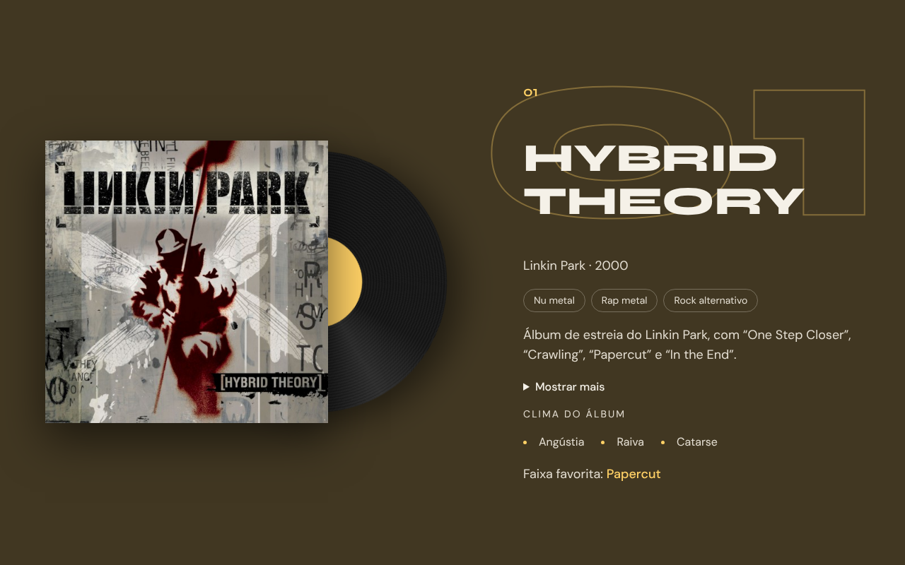

# Wavelengths Remastered · Álbuns que me formaram

Projeto de aula da Fase 2 do portfólio (JavaScript puro). É o Wavelengths da Fase 1 de volta: os dados dos álbuns saem do HTML e passam a vir de um `albums.json`, e as animações ganham GSAP. Cada etapa é um commit, para ser usado em aula.

## No ar

[wavelengths-remastered-renanferreira-dev.vercel.app](https://wavelengths-remastered-renanferreira-dev.vercel.app)

## Como rodar

A página lê o `albums.json` com `fetch`, e o navegador não deixa o `fetch` ler arquivos abertos direto do disco (endereço começando com `file://`). Por isso ela precisa de um servidor local. Duas formas:

- No VS Code, instale a extensão Live Server, clique com o botão direito no `index.html` e escolha "Open with Live Server".
- No terminal, dentro da pasta do projeto, rode `python -m http.server` e abra `http://localhost:8000`.

Para ver o projeto como ele estava em uma etapa, use `git log --oneline` e depois `git checkout <hash>`. Para voltar ao fim do projeto, `git switch main`.

## Etapas

- `00-ponto-de-partida`: README, .gitignore, LICENSE e o esqueleto do `index.html`.
- `01-pagina-da-fase-1`: a página do Wavelengths em HTML e CSS, com os 8 álbuns ainda escritos no HTML e a barra de filtro, sem JavaScript.
- `02-dados-em-json`: os dados dos 8 álbuns no `albums.json`, que a página ainda não usa.
- `03-lendo-com-fetch`: `script.js` com `defer`, `fetch`, `async`/`await` e `response.json()`, e o servidor local.
- `04-template-do-album`: `<template>`, `cloneNode` e `textContent` montam o primeiro álbum a partir do JSON.
- `05-um-album-por-item`: `forEach` monta os 8 álbuns; número com `padStart` e lado da capa com `index % 2`.
- `06-listas-dentro-do-album`: gêneros e clima com `createElement('li')`, um `forEach` dentro do outro.
- `07-cor-de-cada-album`: `style.setProperty` põe o `accentColor` do JSON na variável `--color-accent`.
- `08-capas-do-hero`: as capas do carrossel também vêm do JSON.
- `09-erro-ao-carregar`: `try`/`catch` e `response.ok` mostram uma mensagem quando o `albums.json` não abre.
- `10-filtrando-por-genero`: os botões do filtro com `filter`, `includes`, `hidden` e `aria-pressed`.
- `11-alternando-os-lados`: `classList.toggle` alterna o lado da capa só entre os álbuns visíveis.
- `12-palco-do-remaster`: o visual novo dos álbuns em HTML e CSS: palco preso com `position: sticky`, vinil feito só de CSS e número gigante.
- `13-gsap-por-cdn`: o GSAP entra pelo CDN e o giro do carrossel passa do `@keyframes` para `gsap.to`, com `prefers-reduced-motion` no JavaScript.
- `14-entrada-com-timeline`: `gsap.timeline`, `from` e `stagger` na abertura da página.
- `15-aparecendo-na-rolagem`: `ScrollTrigger` faz cada álbum aparecer quando chega na tela.
- `16-girando-com-a-rolagem`: `scrub` liga o vinil e o carrossel à rolagem.
- `17-parallax-do-numero`: o número gigante anda mais devagar que a página.
- `18-fundo-na-cor-do-album`: o JSON ganha `backgroundColor`, e callbacks do `ScrollTrigger` trocam o fundo da página.
- `19-flip-no-filtro`: `Flip.getState` e `Flip.from` animam os álbuns até o novo lugar quando o filtro muda.

## Pontos de atenção

### Onde costuma travar

- `02-dados-em-json`: uma vírgula depois do último item ou um comentário quebram o JSON inteiro, e o erro aparece só no `response.json()`.
- `03-lendo-com-fetch`: aberto direto do disco (`file://`), o `fetch` falha com "Failed to fetch". Não é erro no código: o navegador bloqueia, e a página precisa de um servidor local.
- `03-lendo-com-fetch`: `await` fora de uma função `async` dá erro de sintaxe. E sem o `await`, `response` é uma promessa, não a resposta.
- `04-template-do-album`: o conteúdo do `<template>` não está na página. `document.querySelector('.album-title')` não acha nada lá dentro; a busca é feita na cópia (`section.querySelector`).
- `04-template-do-album`: `cloneNode()` sem o `true` copia só a `section`, vazia.
- `05-um-album-por-item`: `index` começa em 0, por isso o número é `index + 1`. E `padStart` só existe em texto: `(index + 1).padStart` dá erro sem o `String()`.
- `07-cor-de-cada-album`: `section.style.--color-accent` não existe. Variável CSS se escreve com `setProperty('--color-accent', ...)`.
- `09-erro-ao-carregar`: um 404 não cai no `catch`, porque o `fetch` recebeu uma resposta. Quem detecta é o `response.ok`.
- `10-filtrando-por-genero`: o `hidden` não esconde a `section`, porque o `display: grid` da classe vence o do navegador. A regra `.album[hidden] { display: none; }` resolve.
- `10-filtrando-por-genero`: o gênero do botão precisa ser escrito igual ao do JSON. "Pop Punk" com P maiúsculo não acha nenhum álbum.
- `12-palco-do-remaster`: o palco só fica preso (`sticky`) se a section for mais alta que ele. Com `padding-bottom` no lugar de `min-height` não funciona, porque o sticky não conta o padding.
- `12-palco-do-remaster`: `overflow: hidden` num pai desliga o `sticky`. Para cortar o que passa da borda sem perder o sticky, use `overflow: clip`.
- `12-palco-do-remaster`: a regra `.album p` pintou o número gigante, que devia ser transparente, porque ganha na especificidade. As cores de texto ficaram em `.album-info`.
- `13-gsap-por-cdn`: o `<script>` do GSAP vem antes do `script.js`. Na ordem trocada, `gsap is not defined`.
- `13-gsap-por-cdn`: sem internet, o CDN não carrega e o `script.js` para na primeira linha que usa o `gsap`, antes de montar os álbuns.
- `14-entrada-com-timeline`: `from` anima do valor pedido até o do CSS. Trocar por `to` deixa o título invisível no fim.
- `15-aparecendo-na-rolagem`: plugin sem `gsap.registerPlugin` pode parar de funcionar quando o código for empacotado. Registre sempre.
- `15-aparecendo-na-rolagem`: depois de filtrar, sem `ScrollTrigger.refresh()`, um álbum que subiu só aparece quando a rolagem chega ao lugar antigo dele.
- `16-girando-com-a-rolagem`: com `scrub`, `duration` não serve para nada: a rolagem é o relógio. E sem `ease: 'none'` o vinil acelera e freia no meio da rolagem.
- `16-girando-com-a-rolagem`: o lado do vinil depende da capa, que o filtro troca. Valor fixo deixa o vinil saindo por cima do texto; a função com `invalidateOnRefresh` é lida de novo a cada refresh.
- `17-parallax-do-numero`: `start` e `end` com duas palavras: a primeira é do álbum, a segunda é da tela. `'top bottom'` é "o topo do álbum chega no fundo da tela".
- `18-fundo-na-cor-do-album`: só `onEnter` não basta: subindo a página, quem dispara é o `onEnterBack`.
- `18-fundo-na-cor-do-album`: numa rolagem rápida para cima, vários callbacks disparam juntos, do último gatilho criado para o primeiro. Por isso o gatilho que volta o fundo para o preto é criado antes dos álbuns.
- `19-flip-no-filtro`: a ordem importa. `getState` antes de mudar a página e `Flip.from` depois. Ao contrário, o Flip não vê diferença e nada anima.

### O que eu faria diferente

- Os botões do filtro estão escritos à mão no HTML. Gerar a lista de gêneros a partir do `albums.json` evitaria um gênero novo ficar sem botão.
- Na primeira versão, o visual era o da Fase 1, e o "remaster" não aparecia: dado vindo do JSON não se vê na tela. O palco, o vinil e o fundo colorido (etapa 12 em diante) vieram depois, e deveriam ter entrado no design desde o começo.
- Um álbum novo hoje é uma linha no JSON e uma capa na pasta. Um próximo passo seria buscar as capas no Cover Art Archive com `fetch`.
- A página continua pensada para 1280 px, como na Fase 1.

## Créditos

### GSAP

As animações usam o [GSAP](https://gsap.com/) 3.13, carregado pelo CDN jsDelivr. O GSAP é gratuito, inclusive os plugins, sob a [licença padrão da GreenSock](https://gsap.com/standard-license).

### Capas

As capas ficam na pasta `covers/`, em baixa resolução (500 × 500 px), só para fins educacionais. Os direitos pertencem aos artistas e às gravadoras. As imagens vêm do [Cover Art Archive](https://coverartarchive.org/), via MusicBrainz.

- `hybrid-theory.jpg`: *Hybrid Theory* (2000), Linkin Park. Gravadora: Warner Bros. Records.
- `meteora.jpg`: *Meteora* (2003), Linkin Park. Gravadora: Warner Bros. Records.
- `blink-182.jpg`: *blink-182* (2003), blink-182. Gravadora: Geffen Records.
- `a-fever-you-cant-sweat-out.jpg`: *A Fever You Can’t Sweat Out* (2005), Panic! at the Disco. Gravadoras: Decaydance e Fueled by Ramen.
- `riot.jpg`: *Riot!* (2007), Paramore. Gravadora: Fueled by Ramen.
- `brand-new-eyes.jpg`: *Brand New Eyes* (2009), Paramore. Gravadora: Fueled by Ramen.
- `paramore.jpg`: *Paramore* (2013), Paramore. Gravadora: Fueled by Ramen.
- `thats-the-spirit.jpg`: *That’s the Spirit* (2015), Bring Me the Horizon. Gravadora: RCA Records (Sony Music).

## Navegadores

O vinil e o palco dos álbuns usam `overflow: clip` e `-webkit-text-stroke`, suportados nos navegadores atuais (Safari a partir do 16).

O GSAP 3.13 funciona em todos os navegadores atuais.

O `style.css` usa CSS nesting nativo, suportado no Chrome 120+, Firefox 117+ e Safari 17.2+. Em navegadores mais antigos, as regras aninhadas são ignoradas e a página perde parte do estilo.

## Licença

Código sob a licença MIT. Veja o arquivo [LICENSE](LICENSE).
